# Sistem Pengelolaan Data Narapidana

## 📌 Identitas
- **Nama** : Rivalio Chendra
- **NIM**  : 2509116039
- **Praktikum** : Pemrograman Berorientasi Objek
- **Kelas** : A

---

## 📖 Deskripsi Program

Sistem Pengelolaan Data Narapidana merupakan program yang digunakan untuk mengelola data narapidana dalam sebuah lembaga pemasyarakatan. Program ini memungkinkan admin untuk menyimpan, menampilkan, mengubah, dan menghapus data narapidana melalui menu yang tersedia. Seluruh data disimpan secara permanen di database MySQL, sehingga data tidak hilang ketika program ditutup.

### Aplikasi yang Digunakan

| Aplikasi | Keterangan |
|---|---|
| Java | Bahasa pemrograman |
| Maven | Pengelola project dan dependency (`pom.xml`) |
| MySQL | Database penyimpanan data (database `lapas`) |
| MySQL Connector/J | Driver JDBC (`mysql-connector-j` versi 8.3.0) |

### Data yang Dikelola

| Data | Keterangan |
|---|---|
| ID Narapidana | Identitas unik setiap narapidana |
| Nama | Nama narapidana |
| Kasus | Kasus atau tindak pidana yang dilakukan |
| Masa Tahanan | Lama masa tahanan dalam bulan |
| Nomor Sel | Nomor sel tempat narapidana ditempatkan |
| Blok Sel | Blok tempat sel narapidana berada |

Program memiliki beberapa kategori narapidana. Setiap kategori memiliki informasi tambahan yang berbeda sesuai dengan jenis kasusnya.

### Kategori Narapidana

| Kategori | Informasi Tambahan | Punya Pemeriksaan Rutin? |
|---|---|---|
| Narkotika | Jenis rehabilitasi | ✅ Ya |
| Terorisme | Tingkat risiko | ✅ Ya |
| Korupsi | Uang pengganti | ❌ Tidak |
| Pembunuhan | Kategori pembunuhan | ✅ Ya |
| Pencurian | Nilai kerugian | ❌ Tidak |

Kolom "Pemeriksaan Rutin" ini dijelaskan lebih lanjut di bagian Penerapan Interface.

### Fitur Program

| Menu | Fungsi |
|---|---|
| Tampilkan Narapidana | Menampilkan seluruh data narapidana yang tersimpan di database |
| Tambah Narapidana | Menambahkan data narapidana baru sesuai kategori ke database |
| Update Nomor Sel | Mengubah nomor sel di database berdasarkan ID narapidana |
| Hapus Narapidana | Menghapus data narapidana dari database berdasarkan ID |
| Tampilkan Berdasarkan Kategori | Menampilkan narapidana yang termasuk dalam satu kategori kejahatan tertentu saja |
| Keluar | Mengakhiri program |

---

## 🗂️ Struktur Project MVC + DAO
Program menggunakan struktur MVC (Model-View-Controller) untuk memisahkan bagian data, tampilan, dan pengelolaan proses program. Karena data sekarang disimpan di database, ditambahkan dua package baru, `dao` (Data Access Object) yang khusus mengurus perintah SQL, dan `config` yang khusus mengurus koneksi database. Berikut adalah struktur package program:

```
Lapas [main]
├── Source Packages
│   │
│   ├── com.mycompany.lapas
│   │   └── Main.java
│   │
│   ├── config
│   │   ├── KoneksiDatabase.java
│   │   └── TesKoneksi.java
│   │
│   ├── controller
│   │   └── AdminLapas.java
│   │
│   ├── dao
│   │   └── NarapidanaDAO.java
│   │
│   ├── model
│   │   ├── Narapidana.java
│   │   ├── NarapidanaKorupsi.java
│   │   ├── NarapidanaNarkotika.java
│   │   ├── NarapidanaPembunuhan.java
│   │   ├── NarapidanaPencurian.java
│   │   ├── NarapidanaTerorisme.java
│   │   └── PemeriksaanRutin.java      ← interface
│   │
│   └── view
│       └── NarapidanaView.java
│
└── Project Files
    └── pom.xml                        ← dependency MySQL Connector/J
```


| Lapisan | Isi | File |
|---|---|---|
| **Model** | Atribut, constructor, getter/setter, method `getInfo()` yang mengembalikan `String` (tidak mencetak apa pun) | `Narapidana.java`, 5 subclass-nya, dan `PemeriksaanRutin.java` |
| **View** | Seluruh `System.out.println`/`print`, `Scanner`, dan validasi input | `NarapidanaView.java` |
| **Controller** | Logika CRUD, memanggil Model, View, dan DAO | `AdminLapas.java` |
| **DAO** | Seluruh perintah SQL (`INSERT`, `SELECT`, `UPDATE`, `DELETE`) dan pengubahan data database menjadi objek | `NarapidanaDAO.java` |
| **Config** | Pengaturan URL, user, password, dan pembuatan koneksi ke MySQL | `KoneksiDatabase.java`, `TesKoneksi.java` |
| **Main** | Titik awal program, membuat objek, menjalankan menu | `Main.java` |

```java
// Model hanya mengembalikan String, TIDAK mencetak apa pun
public String getInfo() {
    return "ID Narapidana : " + idNapi + "...";
}
```
```java
// View satu-satunya tempat yang mencetak ke layar
public void tampilkanInfoNarapidana(Narapidana n) {
    System.out.println(n.getInfo());
}
```
```java
// DAO satu-satunya tempat yang menulis SQL
public boolean hapusNarapidana(String idNapi) {
    String sql = "DELETE FROM narapidana WHERE id_napi = ?";
    ...
}
```

Dengan pemisahan ini, jika tampilan program ingin diubah, cukup ubah `NarapidanaView.java` tanpa perlu menyentuh logika CRUD di `AdminLapas.java`, maupun struktur data di `Narapidana.java`. Jika database ingin diganti atau query ingin diubah, cukup ubah `NarapidanaDAO.java` dan `KoneksiDatabase.java`, tanpa menyentuh Controller maupun View.

---

## 🔄 Alur Program

1. Program dimulai dari `main()` di class `Main`. Objek `Scanner`, `NarapidanaView`, dan `AdminLapas` dibuat. Saat `AdminLapas` dibuat, ia juga membuat objek `NarapidanaDAO` yang akan dipakai untuk berkomunikasi dengan database. Tidak ada lagi data dummy di dalam program, seluruh data dibaca langsung dari tabel `narapidana` di MySQL.
2. Program masuk ke perulangan `while` yang terus menampilkan menu dan menerima pilihan pengguna, sampai pengguna memilih menu Keluar.
3. Setiap pilihan menu (1–6) diarahkan lewat percabangan `switch` ke method yang sesuai di `AdminLapas`, kemudian `AdminLapas` meneruskan pekerjaan database ke `NarapidanaDAO`:
   - **Tampilkan**: `getAllNarapidana()` menjalankan `SELECT * FROM narapidana ORDER BY id_napi`, hasilnya berupa `List<Narapidana>` yang ditampilkan dengan perulangan `for`. Untuk narapidana dari kategori yang memiliki pemeriksaan rutin (Narkotika, Terorisme, Pembunuhan), baris jenis pemeriksaannya otomatis ikut tercetak.
   - **Tambah**: menanyakan kategori kejahatan (submenu 1–5) terlebih dahulu, memeriksa apakah ID sudah dipakai, lalu membuat objek dari subclass yang sesuai dan menyimpannya ke database lewat `tambahNarapidana()` (`INSERT`).
   - **Update**: mencari data berdasarkan ID lewat `cariNarapidanaById()`, mengubah nomor selnya pada objek, lalu menyimpannya lewat `updateNarapidana()` (`UPDATE`).
   - **Hapus**: mencari data berdasarkan ID lewat `cariNarapidanaById()`, lalu menghapusnya lewat `hapusNarapidana()` (`DELETE`).
   - **Tampilkan Berdasarkan Kategori**: pengguna mengetik nama kategori (misalnya "Narkotika"), program mengambil seluruh data dari database lalu menampilkan hanya narapidana yang kategorinya cocok. Jika tidak ada satu pun yang cocok, program menampilkan pesan bahwa kategori tersebut tidak ditemukan.
4. Untuk fitur Tambah, Update, dan Hapus, pencarian data menggunakan `cariNarapidanaById()` yang mengembalikan objek `Narapidana`, atau `null` jika ID tidak ada di database. Jika ID tidak ditemukan (Update/Hapus) atau sudah dipakai (Tambah), pesan error ditampilkan tanpa menghentikan program.
5. Seluruh input divalidasi terlebih dahulu di `NarapidanaView` sebelum diproses (lihat tabel validasi di bawah). Validasi juga diterapkan sekali lagi di dalam Model sebagai lapisan keamanan tambahan (dijelaskan di bagian Encapsulation).
6. Jika terjadi kesalahan pada database (misalnya MySQL belum menyala), `NarapidanaDAO` menangkap `SQLException`, menampilkan pesan kesalahan, dan program tetap berjalan tanpa crash.
7. Program terus berulang sampai pengguna memilih menu Keluar, yang mengubah `berjalan` menjadi `false` dan menghentikan perulangan `while`.

### Validasi Input

| No | Validasi | Pesan yang Ditampilkan |
|----|----------|------------------------|
| 1 | ID/Nama/Kasus tidak boleh kosong | "... tidak boleh kosong, coba lagi." |
| 2 | ID tidak boleh sama dengan data yang sudah ada di database | ">> ID sudah digunakan." |
| 3 | Kategori kejahatan harus 1–5 | ">> Kategori tidak valid." |
| 4 | Input angka tidak boleh berupa huruf/teks | ">> Input harus berupa angka, coba lagi." |
| 5 | Angka (masa tahanan, uang pengganti, dll) harus lebih besar dari 0 | ">> Angka harus lebih besar dari 0, coba lagi." |
| 6 | ID yang dicari untuk Update/Hapus harus ada di database | ">> ID Narapidana tidak ditemukan!" |

Validasi angka menggunakan `scanner.hasNextInt()`/`hasNextLong()` di dalam perulangan `while`, sehingga program tidak berhenti (crash) meskipun pengguna salah memasukkan tipe data.

---

## 🔐 Penerapan Encapsulation dan Inheritance
### Encapsulation

Seluruh atribut pada class `Narapidana` dideklarasikan dengan modifier `private`, sehingga tidak dapat diakses langsung dari class lain. Akses hanya bisa dilakukan melalui method `public` berupa getter dan setter.

```java
public abstract class Narapidana {
    private final String idNapi;
    private final String nama;
    private final String kasus;
    private final int masaTahanan;

    private String nomorSel;
    private String blokSel;

    public String getIdNapi() {
        return idNapi;
    }

    public void setNomorSel(String nomorSel) {
        if (nomorSel == null || nomorSel.isEmpty()) {
            System.out.println(">> Nomor sel tidak boleh kosong.");
            return;
        }
        this.nomorSel = nomorSel;
    }
    // getter dan setter lainnya...
}
```

Dengan cara ini, `AdminLapas` (Controller) tidak perlu menulis `n.idNapi = "..."` secara langsung, melainkan selalu melalui `n.getIdNapi()` atau `n.setNomorSel(...)`, sehingga data tidak dapat diubah secara sembarangan dari luar class-nya. Hal yang sama berlaku untuk `NarapidanaDAO`, saat menyimpan data ke database, DAO membaca nilai atribut melalui getter (`napi.getNama()`, `napi.getNomorSel()`, dan seterusnya), bukan mengakses atributnya langsung.

**Terdapat dua  jenis Encapsulation yang diterapkan yaitu:**

1. **Keyword `final`** digunakan pada atribut `idNapi`, `nama`, `kasus`, dan `masaTahanan`. Keempat atribut ini memang tidak memiliki setter, artinya nilainya tidak boleh berubah setelah narapidana didaftarkan. Dengan `final`, Java akan menolak mengcompile program jika suatu saat ada yang mencoba menambahkan setter untuk atribut ini. Atribut `nomorSel` dan `blokSel` sengaja tidak dibuat `final`, karena memang harus bisa diubah lewat fitur Update Nomor Sel. Hal ini sejalan dengan query `UPDATE` di DAO yang hanya mengubah kolom `nomor_sel` dan `blok_sel`.
2. **Validasi di dalam setter** Validasi input (tidak boleh kosong, harus angka positif, dll) diterapkan di dua tempat: di `NarapidanaView` saat membaca input dari keyboard, dan di dalam setter masing-masing (`setNomorSel`, `setUangPengganti`, dan seterusnya) sebelum nilainya benar-benar diubah. Jadi meskipun ada bagian program lain yang memanggil setter secara langsung tanpa melalui `NarapidanaView`, data yang tidak valid tetap akan ditolak oleh objeknya sendiri.

### Inheritance

Program menerapkan inheritance dengan 1 superclass (`Narapidana`) dan 5 subclass, satu untuk setiap kategori kejahatan:

```text
                         ┌───────────────────────────┐
                         │ Narapidana (Superclass)   │
                         ├───────────────────────────┤
                         │ - idNapi                  │
                         │ - nama                    │
                         │ - kasus                   │
                         │ - masaTahanan             │
                         │ - nomorSel                │
                         │ - blokSel                 │
                         └───────────────────────────┘
                                       │
                                     extends
                                       │
        ┌──────────────────────────────┼───────────────────────────────────┐
        │                │             │                  │                │
        │                │             │                  │                │
┌───────┴───────┐ ┌──────┴───────┐ ┌───┴────────┐ ┌───────┴───────┐ ┌──────┴───────┐
│ Narkotika     │ │ Terorisme    │ │ Korupsi    │ │ Pembunuhan    │ │ Pencurian    │
│ (Subclass)    │ │ (Subclass)   │ │ (Subclass) │ │ (Subclass)    │ │ (Subclass)   │
├───────────────┤ ├──────────────┤ ├────────────┤ ├───────────────┤ ├──────────────┤
│ +jenis        │ │ +tingkat     │ │ +uang      │ │ +kategori     │ │ +nilai       │
│  Rehabilitasi │ │  Risiko      │ │  Pengganti │ │  Pembunuhan   │ │  Kerugian    │
└───────────────┘ └──────────────┘ └────────────┘ └───────────────┘ └──────────────┘
```

**Contoh subclass, `NarapidanaKorupsi`:**
```java
public class NarapidanaKorupsi extends Narapidana {
    private long uangPengganti;

    public NarapidanaKorupsi(String idNapi, String nama, String kasus, int masaTahanan,
                              String nomorSel, String blokSel, long uangPengganti) {
        super(idNapi, nama, kasus, masaTahanan, nomorSel, blokSel); // memanggil constructor superclass
        this.uangPengganti = uangPengganti;
    }

    @Override
    protected String getDetailKhusus() {
        return "Uang Pengganti: Rp" + uangPengganti;
    }

    @Override
    public String getKategori() {
        return "KORUPSI";
    }
}
```

Setiap subclass mewarisi seluruh atribut umum dari `Narapidana`, lalu menambahkan satu atribut khusus yang hanya relevan untuk kategori kejahatan Korupsi. Ini menghindari pemaksaan atribut yang tidak relevan ke seluruh narapidana, misalnya, "Uang Pengganti" hanya bermakna untuk kasus Korupsi, bukan Terorisme.

Subclass tidak meng-override `getInfo()` secara langsung, melainkan mengisi `getDetailKhusus()` dan `getKategori()`.

---

## 🧱 Penerapan Abstraction

`Narapidana` dideklarasikan sebagai `abstract class`, dan memiliki dua `abstract method`:

```java
public abstract class Narapidana {
    // ...atribut dan constructor...

    // Method ini SUDAH punya isi, dan SAMA untuk semua subclass.
    // Bagian terakhirnya memanggil dua method abstract di bawah.
    public String getInfo() {
        return "ID Narapidana : " + idNapi + "\n"
                + "Nama          : " + nama + "\n"
                + "Kasus         : " + kasus + "\n"
                + "Masa Tahanan  : " + masaTahanan + " bulan\n"
                + "Sel           : " + nomorSel + " (" + blokSel + ")\n"
                + getDetailKhusus() + "\n"
                + "Kategori      : " + getKategori();
    }

    // ABSTRACT METHOD: tidak punya isi sama sekali di class ini.
    // Setiap subclass WAJIB menuliskan isinya sendiri.
    protected abstract String getDetailKhusus();
    public abstract String getKategori();
}
```

**Kenapa dibuat `abstract`, bukan class biasa?**

Karena secara logika, tidak masuk akal ada objek "Narapidana" polos tanpa kategori kejahatan yang jelas. Setiap narapidana di dunia nyata setidaknya termasuk salah satu dari lima kategori yang ada. Dengan menjadikan `Narapidana` abstract:

- Program tidak akan bisa membuat objek `new Narapidana(...)` secara langsung, Java akan menolaknya saat di-compile.
- Objek hanya bisa dibuat lewat salah satu dari lima subclass-nya (`new NarapidanaKorupsi(...)`, dan seterusnya), yang masing-masing wajib mengisi `getDetailKhusus()` dan `getKategori()` miliknya sendiri.

Hal ini juga berlaku saat data dibaca dari database. `NarapidanaDAO` tidak membuat `new Narapidana(...)`, melainkan memilih salah satu subclass berdasarkan kolom `kategori`.

---

## 🧩 Penerapan Polymorphism

### 1. Method Overriding

Kedua `abstract method` pada `Narapidana`, yaitu `getDetailKhusus()` dan `getKategori()`, di-override oleh setiap subclass untuk mengisi informasi sesuai kategorinya masing-masing:

```java
// Subclass NarapidanaKorupsi
@Override
protected String getDetailKhusus() {
    return "Uang Pengganti: Rp" + uangPengganti;
}

@Override
public String getKategori() {
    return "KORUPSI";
}
```

Hal ini berguna pada `AdminLapas`, yang menampung seluruh data dari database dalam satu `List<Narapidana>` walaupun isinya campuran objek dari 5 subclass berbeda:

```java
public void tampilkanNarapidana() {
    List<Narapidana> daftarNarapidana = narapidanaDAO.getAllNarapidana();

    for (Narapidana n : daftarNarapidana) {
        view.tampilkanNarapidana(n); // memanggil n.getInfo(), yang di dalamnya memanggil getDetailKhusus() dan getKategori()
        ...
    }
}
```

Java memanggil `getDetailKhusus()` dan `getKategori()` sesuai jenis objek aslinya. Jika objeknya `NarapidanaKorupsi`, yang terpanggil adalah versi milik `NarapidanaKorupsi`, bukan class lain. Controller tidak perlu memeriksa satu per satu jenis objeknya, cukup memanggil `getInfo()` dan Java yang menentukan versi mana yang dijalankan di baliknya.

Polymorphism juga dimanfaatkan di `NarapidanaDAO`, method `tambahNarapidana(Narapidana napi)` menerima parameter bertipe superclass, sehingga satu method yang sama bisa menyimpan objek dari kelima subclass. `buatObjekNarapidana()` juga mengembalikan tipe `Narapidana`.

### 2. Method Overloading

Selain overriding, program ini juga menerapkan overloading, dua method dengan nama yang sama, tetapi parameter yang berbeda, di dalam class `AdminLapas`:

```java
// Versi 1: tanpa parameter, menampilkan SEMUA narapidana
public void tampilkanNarapidana() {
    List<Narapidana> daftarNarapidana = narapidanaDAO.getAllNarapidana();
    for (Narapidana n : daftarNarapidana) {
        view.tampilkanNarapidana(n);
        ...
    }
}

// Versi 2: dengan parameter String, menampilkan narapidana dari SATU kategori saja
public void tampilkanNarapidana(String kategori) {
    List<Narapidana> daftarNarapidana = narapidanaDAO.getAllNarapidana();
    for (Narapidana n : daftarNarapidana) {
        if (n.getKategori().equalsIgnoreCase(kategori)) {
            view.tampilkanNarapidana(n);
            ...
        }
    }
}
```

Java membedakan kedua method ini berdasarkan jumlah dan tipe parameternya, bukan dari isi method-nya. Saat dipanggil `admin.tampilkanNarapidana()` tanpa argumen, Java menjalankan versi pertama. Saat dipanggil `admin.tampilkanNarapidana("Narkotika")` dengan satu argumen `String`, Java otomatis menjalankan versi kedua.

---

## 🔌 Penerapan Interface

Program ini menerapkan satu `interface` bernama `PemeriksaanRutin`:

```java
package model;

public interface PemeriksaanRutin {
    String getJenisPemeriksaan();
}
```

Interface ini tidak di-`implements` oleh semua subclass, melainkan hanya oleh kategori yang di dunia nyata memang memiliki program pemeriksaan/pengawasan rutin secara berkala yaitu Narkotika, Terorisme, dan Pembunuhan. Kategori Korupsi dan Pencurian tidak memilikinya, karena tidak ada kewajiban pemeriksaan rutin semacam ini untuk kedua kasus tersebut.

```java
public class NarapidanaNarkotika extends Narapidana implements PemeriksaanRutin {
    ...
    @Override
    public String getJenisPemeriksaan() {
        return "Tes urine setiap 2 minggu";
    }
}
```

```java
public class NarapidanaTerorisme extends Narapidana implements PemeriksaanRutin {
    ...
    @Override
    public String getJenisPemeriksaan() {
        if (tingkatRisiko.equalsIgnoreCase("Tinggi")) {
            return "Pemeriksaan sel dan komunikasi setiap hari";
        }
        return "Pemeriksaan sel dan komunikasi setiap minggu";
    }
}
```

Di `AdminLapas`, program mengecek apakah sebuah objek narapidana "memiliki" interface ini menggunakan `instanceof`, sebelum menampilkan baris Pemeriksaan tambahan:

```java
for (Narapidana n : daftarNarapidana) {
    view.tampilkanNarapidana(n);

    if (n instanceof PemeriksaanRutin p) {
        view.tampilkanPesan("Pemeriksaan   : " + p.getJenisPemeriksaan());
        ...
    }
    ...
}
```

Narapidana kategori Korupsi dan Pencurian akan melewati blok `if` ini begitu saja (karena bukan `instanceof PemeriksaanRutin`), sedangkan Narkotika, Terorisme, dan Pembunuhan akan menampilkan baris "Pemeriksaan" tambahan sesuai kategorinya. Pengecekan ini tetap bekerja pada objek yang dibuat dari database, karena `NarapidanaDAO` membuat subclass yang sama persis dengan yang dibuat saat input manual.

---

## 🗄️ Penerapan JDBC

JDBC (Java Database Connectivity) adalah "jembatan" yang menghubungkan program Java dengan database. Pada program ini, JDBC dipakai untuk menyimpan data narapidana ke database MySQL bernama `lapas`, menggantikan penyimpanan sementara di `ArrayList`. Dengan begitu, data tidak hilang ketika program ditutup.

### 1. Driver MySQL

Agar Java bisa terhubung dengan MySQL, dibutuhkan driver. Driver ini ditambahkan lewat Maven di file `pom.xml`, dan akan terunduh otomatis saat project dibuka:

```xml
<dependency>
    <groupId>com.mysql</groupId>
    <artifactId>mysql-connector-j</artifactId>
    <version>8.3.0</version>
</dependency>
```

### 2. Struktur Tabel Database

Semua kategori narapidana disimpan dalam satu tabel bernama `narapidana`. Kolom `kategori` menandai jenis narapidananya (NARKOTIKA, TERORISME, KORUPSI, PEMBUNUHAN, atau PENCURIAN), sedangkan kolom informasi tambahan hanya terisi untuk kategori yang sesuai dan dibiarkan kosong (`NULL`) untuk kategori lainnya.

| Kolom | Isi | Terisi untuk kategori |
|---|---|---|
| `id_napi`, `nama`, `kasus`, `masa_tahanan`, `nomor_sel`, `blok_sel` | Data umum narapidana | Semua |
| `kategori` | Jenis kategori narapidana | Semua |
| `jenis_rehabilitasi` | Jenis rehabilitasi | Narkotika |
| `tingkat_risiko` | Tingkat risiko | Terorisme |
| `uang_pengganti` | Jumlah uang pengganti | Korupsi |
| `kategori_pembunuhan` | Berencana / tidak berencana | Pembunuhan |
| `nilai_kerugian` | Nilai kerugian | Pencurian |


### 3. Koneksi ke Database (`KoneksiDatabase`)

Class `KoneksiDatabase` (package `config`) menyimpan semua pengaturan koneksi di satu tempat, sehingga class lain tidak perlu tahu alamat atau password database.

```java
private static final String URL = "jdbc:mysql://localhost:3306/lapas";
private static final String USER = "root";
private static final String PASS = "";
```

| Pengaturan | Artinya |
|---|---|
| `URL` | Alamat database: berada di komputer sendiri (`localhost`), port `3306`, nama database `lapas` |
| `USER` | Username MySQL (bawaan Laragon: `root`) |
| `PASS` | Password MySQL (bawaan Laragon: kosong) |

Setiap kali program butuh database, cukup memanggil `KoneksiDatabase.getConnection()` untuk mendapatkan koneksi.

Class `TesKoneksi` adalah program kecil yang hanya berfungsi untuk mengecek apakah koneksi berhasil. Jika sukses, tampil "Koneksi database berhasil!", jika gagal tampil "Koneksi database gagal!" beserta penyebabnya.

### 4. Data Access Object (`NarapidanaDAO`)

Semua perintah SQL dikumpulkan di satu class, yaitu `NarapidanaDAO` (package `dao`). `AdminLapas` (Controller) tidak menulis SQL sendiri, tapi hanya memanggil method milik DAO. Setiap operasi CRUD punya satu method:

| Operasi | Method di DAO | Fungsinya | Dipakai oleh menu |
|---|---|---|---|
| **Create** | `tambahNarapidana()` | Menyimpan narapidana baru | Tambah Narapidana |
| **Read (satu data)** | `cariNarapidanaById()` | Mencari narapidana berdasarkan ID | Tambah (cek ID), Update, Hapus |
| **Read (semua data)** | `getAllNarapidana()` | Mengambil seluruh narapidana | Tampilkan, Tampilkan Berdasarkan Kategori |
| **Update** | `updateNarapidana()` | Mengubah nomor dan blok sel | Update Nomor Sel |
| **Delete** | `hapusNarapidana()` | Menghapus narapidana berdasarkan ID | Hapus Narapidana |

Contoh, method untuk menghapus data:

```java
public boolean hapusNarapidana(String idNapi) {
    String sql = "DELETE FROM narapidana WHERE id_napi = ?";

    try (Connection conn = KoneksiDatabase.getConnection();
         PreparedStatement pstmt = conn.prepareStatement(sql)) {

        pstmt.setString(1, idNapi);                 // isi tanda ? dengan ID
        int barisBerubah = pstmt.executeUpdate();   // jalankan perintah SQL
        return barisBerubah > 0;                    // true jika ada data yang terhapus

    } catch (SQLException e) {
        System.err.println("Gagal menghapus narapidana - " + e.getMessage());
        return false;
    }
}
```

Langkah kerjanya: (1) siapkan perintah SQL, (2) buka koneksi, (3) isi nilai ID, (4) jalankan, (5) kembalikan `true`/`false` agar Controller tahu berhasil atau tidak.

### 5. PreparedStatement (Tanda `?`)

Pada perintah SQL, nilai dari pengguna tidak langsung digabung ke dalam teks SQL, melainkan ditandai dengan `?` lalu diisi belakangan lewat `setString()`, `setInt()`, atau `setLong()`. Dengan cara ini, apa pun yang diketik pengguna hanya dianggap sebagai data, bukan perintah SQL, sehingga program aman dari serangan SQL Injection.

### 6. Menyimpan dan Membaca Objek Narapidana

Menyimpan (INSERT): karena semua kategori berada di satu tabel, saat menyimpan, program mengecek jenis objeknya dengan `instanceof` lalu mengisi kolom khusus yang sesuai. Misalnya, objek `NarapidanaKorupsi` akan mengisi kolom `uang_pengganti`, sedangkan kolom khusus lainnya dibiarkan kosong.

```java
if (napi instanceof NarapidanaKorupsi) {
    NarapidanaKorupsi n = (NarapidanaKorupsi) napi;
    pstmt.setLong(10, n.getUangPengganti());
}
```

Membaca (SELECT): hasil query diterima dalam bentuk `ResultSet`, yaitu tabel hasil yang dibaca baris demi baris. Setiap baris diubah kembali menjadi objek Java oleh method `buatObjekNarapidana()`, yang memilih subclass berdasarkan isi kolom `kategori`:

```java
switch (kategori) {
    case "NARKOTIKA":
        return new NarapidanaNarkotika(..., rs.getString("jenis_rehabilitasi"));
    case "KORUPSI":
        return new NarapidanaKorupsi(..., rs.getLong("uang_pengganti"));
    // ...TERORISME, PEMBUNUHAN, dan PENCURIAN dengan pola yang sama
}
```

Dengan begitu, data dari database kembali menjadi objek `NarapidanaNarkotika`, `NarapidanaKorupsi`, dan seterusnya, sehingga inheritance, polymorphism, dan interface tetap berjalan seperti biasa.

### 7. Penutupan Koneksi dan Penanganan Error

- **Koneksi ditutup otomatis.** Koneksi dan perintah SQL ditulis di dalam `try (...)` sehingga Java menutupnya sendiri setelah selesai, tanpa perlu menutup manual.
- **Error tidak membuat program berhenti.** Jika terjadi masalah pada database (misalnya Laragon/MySQL belum menyala), DAO menangkap error tersebut dan menampilkan pesan, lalu program tetap berjalan dan Controller menampilkan pesan gagal ke pengguna.

### 8. Alur Kerja MVC dengan DAO

Contoh alur saat pengguna memilih menu **Hapus Narapidana**:

```text
Main ──► AdminLapas.hapusNarapidana()          [Controller]
              │
              ├─► NarapidanaView.bacaTeks()      [View]   : membaca ID dari keyboard
              │
              ├─► NarapidanaDAO.cariNarapidanaById()      : apakah ID ada di database?
              │
              ├─► NarapidanaDAO.hapusNarapidana()         : hapus data
              │         │
              │         └─► KoneksiDatabase.getConnection() ──► MySQL (database lapas)
              │
              └─► NarapidanaView.tampilkanPesan()[View]   : menampilkan hasil ke layar
```

---

## 🖼️ Dokumentasi Hasil Uji Coba Program

## 🛠️ Persiapan Database dan Laragon

Program ini membutuhkan database MySQL yang sudah menyala dan berisi tabel `narapidana`. Jika langkah di bawah dilewati, program tidak bisa menyimpan maupun menampilkan data.

| Langkah | Yang Dilakukan | Hasil yang Diharapkan |
|---|---|---|
| 1 | Jalankan Laragon, lalu klik Start All | Status Apache dan MySQL menyala |
| 2 | Buat database `lapas` dan tabel `narapidana` (atau import file `lapas.sql`) | Database `lapas` tampil di phpMyAdmin |
| 3 | Jalankan `TesKoneksi.java` | Muncul "Koneksi database berhasil!" |
| 4 | Jalankan `Main.java` | Menu utama program tampil |

### Langkah 1: Jalankan Laragon

1. Buka aplikasi Laragon.
2. Klik tombol Start All.
3. Pastikan MySQL berstatus menyala. Pengaturan bawaan Laragon adalah username `root` dan password kosong, sama dengan yang tertulis di `KoneksiDatabase.java`.

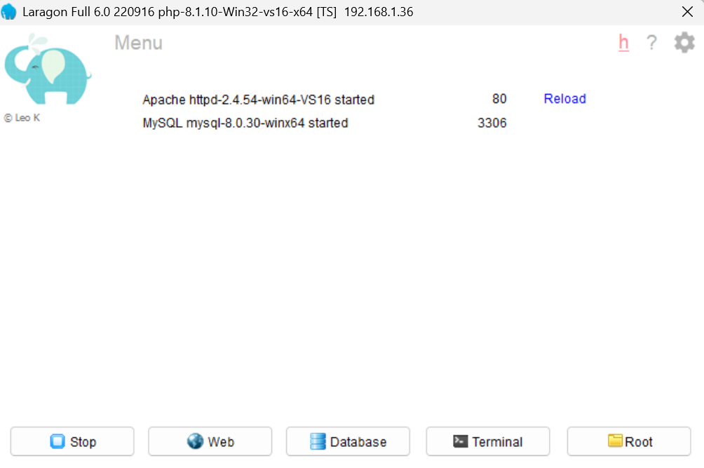

### Langkah 2: Siapkan Database `lapas`

Buka database lewat tombol Database di Laragon (membuka phpmyadmin), lalu:

Buat database bernama `lapas` terlebih dahulu, setelah itu masuk ke database tersebut, pilih menu import, lalu pilih file lapas.sql dan klik import.

```sql
CREATE DATABASE IF NOT EXISTS lapas;
USE lapas;

CREATE TABLE IF NOT EXISTS narapidana (
    id_napi             VARCHAR(20)  PRIMARY KEY,
    nama                VARCHAR(100) NOT NULL,
    kasus               VARCHAR(255) NOT NULL,
    masa_tahanan        INT          NOT NULL,
    nomor_sel           VARCHAR(20)  NOT NULL,
    blok_sel            VARCHAR(20)  NOT NULL,
    kategori            VARCHAR(20)  NOT NULL,
    jenis_rehabilitasi  VARCHAR(100) NULL,
    tingkat_risiko      VARCHAR(20)  NULL,
    uang_pengganti      BIGINT       NULL,
    kategori_pembunuhan VARCHAR(50)  NULL,
    nilai_kerugian      BIGINT       NULL
);
```


### Langkah 3: Pastikan Program Terhubung ke Database

Jalankan class `TesKoneksi.java` (klik kanan → Run File). Hasilnya:

| Output | Artinya | Yang Perlu Dilakukan |
|---|---|---|
| `Koneksi database berhasil!` | Program sudah terhubung ke database | Lanjut ke Langkah 4 |
| `Koneksi database gagal!` | Program belum bisa terhubung |

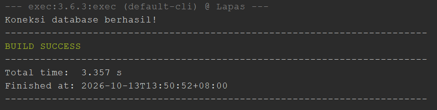

### Langkah 4: Jalankan Program Utama

Setelah koneksi berhasil, jalankan `Main.java` (klik kanan → Run File). Menu utama akan tampil dan program siap digunakan. Pastikan Laragon tetap menyala selama program berjalan.

---

## Tampilan Program
**1. Menu Utama**

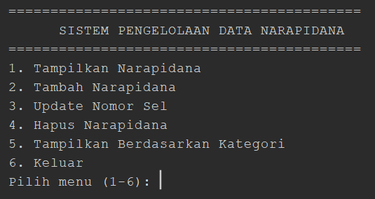

Tampilan awal saat program dijalankan, menampilkan 6 pilihan menu. Data yang ditampilkan nantinya diambil langsung dari database MySQL.
 <br> <br>

**2. Tampilkan Narapidana**

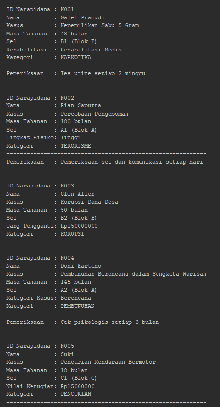

Hasil dari menu nomor 1 adalah seluruh data narapidana dari database ditampilkan dalam format kartu, dengan atribut tambahan yang berbeda sesuai kategorinya masing-masing. Untuk narapidana kategori Narkotika, Terorisme, dan Pembunuhan, akan muncul baris tambahan "Pemeriksaan" yang didapat lewat interface `PemeriksaanRutin`.
  <br> <br>

**3. Tambah Narapidana**

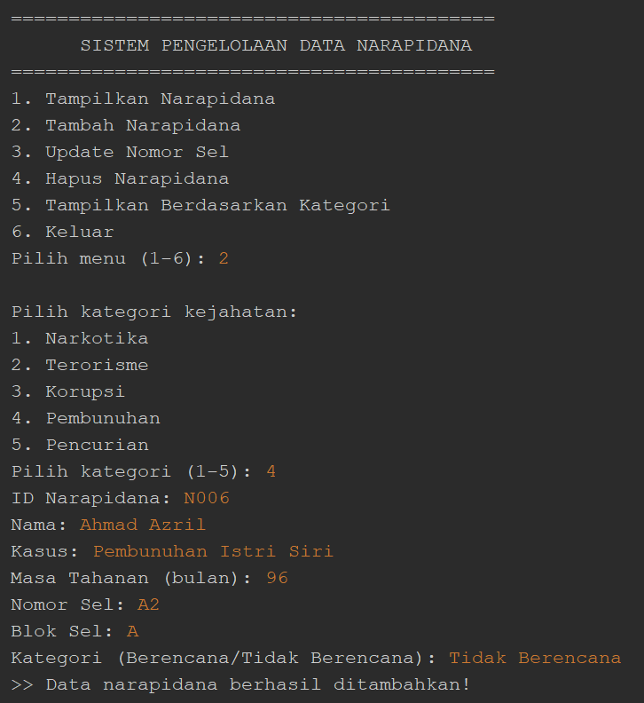

Setelah memilih menu Tambah, program menanyakan kategori kejahatan terlebih dahulu untuk menentukan subclass mana yang akan dibuat. Proses input data narapidana baru, ID, Nama, Kasus, Masa Tahanan, Nomor Sel, Blok Sel, dan satu atribut tambahan sesuai kategori yang dipilih. Setelah semua terisi, data disimpan ke database.
  <br> <br>

**4. Update Nomor Sel**

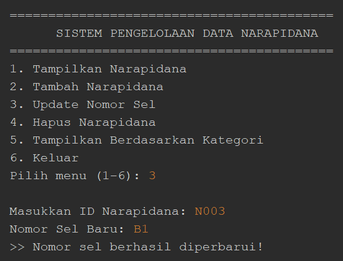

Proses pembaruan nomor sel, program mencari data berdasarkan ID yang dimasukkan di database, lalu memperbarui nomor selnya.
  <br> <br>

**5. Hapus Narapidana**

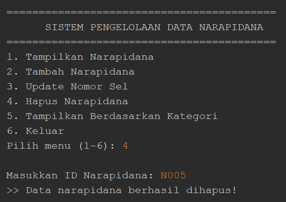

Proses penghapusan data dari database berdasarkan ID yang dimasukkan.
  <br> <br>

**6. Tampilkan Berdasarkan Kategori**

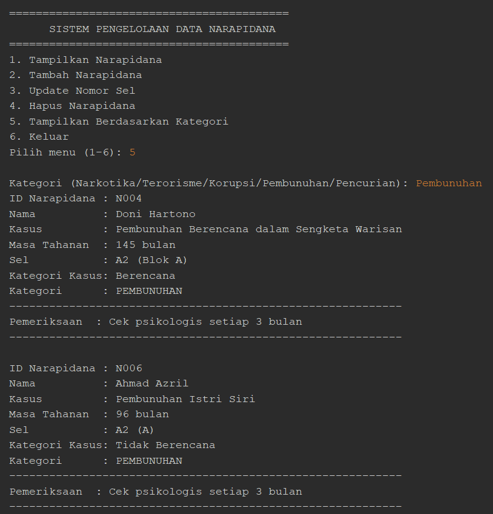

Pengguna mengetik nama kategori yang ingin dilihat (misalnya "Narkotika"), lalu program hanya menampilkan narapidana yang kategorinya cocok.
  <br> <br>

**7. Keluar**


Pesan penutup yang muncul saat memilih menu Keluar.
  <br> <br>

**8. Validasi Input Kosong**

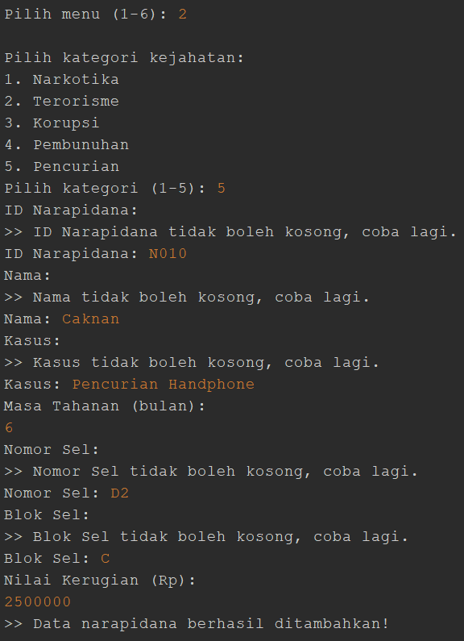

Pesan error saat kolom seperti ID/Nama/Kasus dibiarkan kosong.
  <br> <br>

**9. Validasi ID Duplikat**

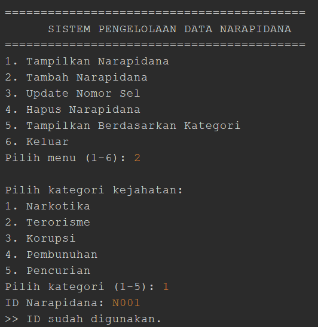

Pesan error saat ID yang dimasukkan sudah digunakan narapidana lain di database.
  <br> <br>

**10. Validasi Kategori Tidak Valid**

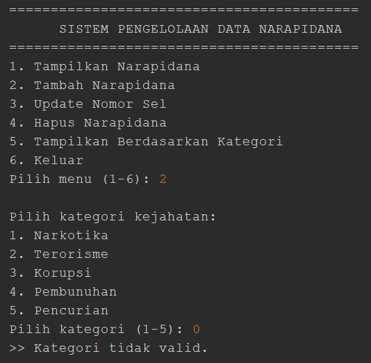

Pesan error saat kategori kejahatan dipilih di luar angka 1–5.
 <br> <br>

**11. Validasi Input Bukan Angka**

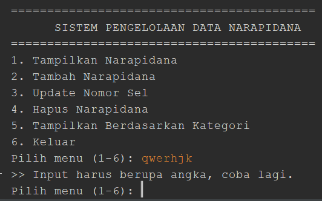

Pesan error saat kolom yang seharusnya diisi angka justru diisi huruf/teks.
  <br> <br>

**12. Validasi Angka Harus Positif**

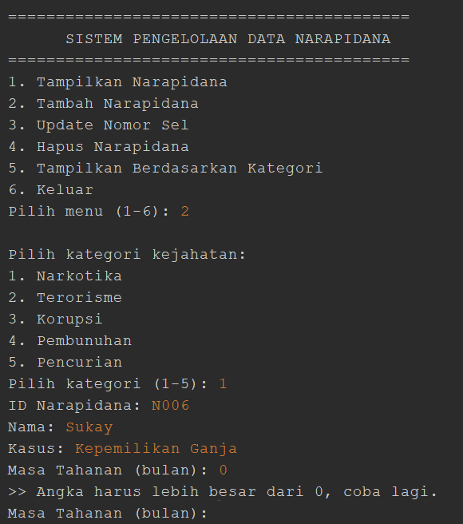

Pesan error saat angka yang dimasukkan bernilai 0 atau negatif.
  <br> <br>

**13. Data Tersimpan di Database MySQL**

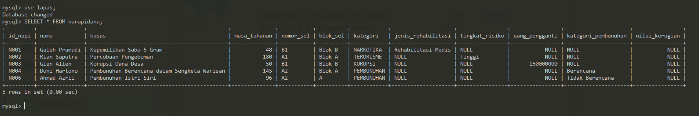

Isi tabel `narapidana` pada MySQL setelah proses Tambah, Update, atau Hapus dijalankan, membuktikan bahwa perubahan data benar-benar tersimpan di database.
